<div align="center">


# Windfall

**Swipe right to give. Swipe up to clear someone’s debt.**

A two-sided giving app with an Apple-inspired interface: Patrons swipe through 261 people carrying medical debt,
student loans, rent arrears and the wreckage of brave small businesses.

**[Live demo → windfall.arnavrival12.workers.dev](https://windfall.arnavrival12.workers.dev)** · sign up with Google/email or use a one-click demo persona

> ⚠️ **Demo only.** Every Seeker, Patron, story and total is fictional and labelled “Demo”. Portraits are
> **AI-generated (StyleGAN) faces of people who do not exist**, so no real person is ever depicted as being in debt.
> No real money moves.

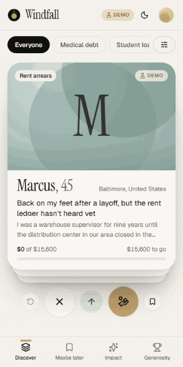

</div>

## Screenshots

| Landing (light) | Landing (dark) |
|---|---|
| 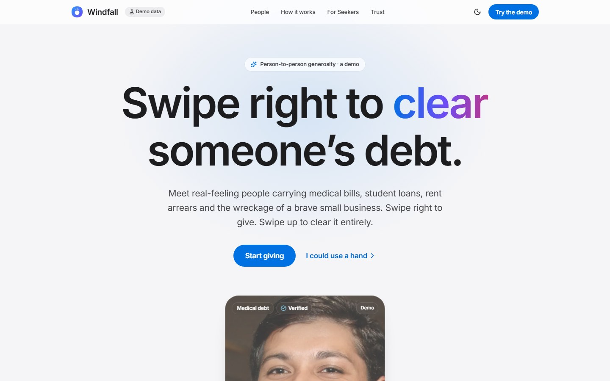 | 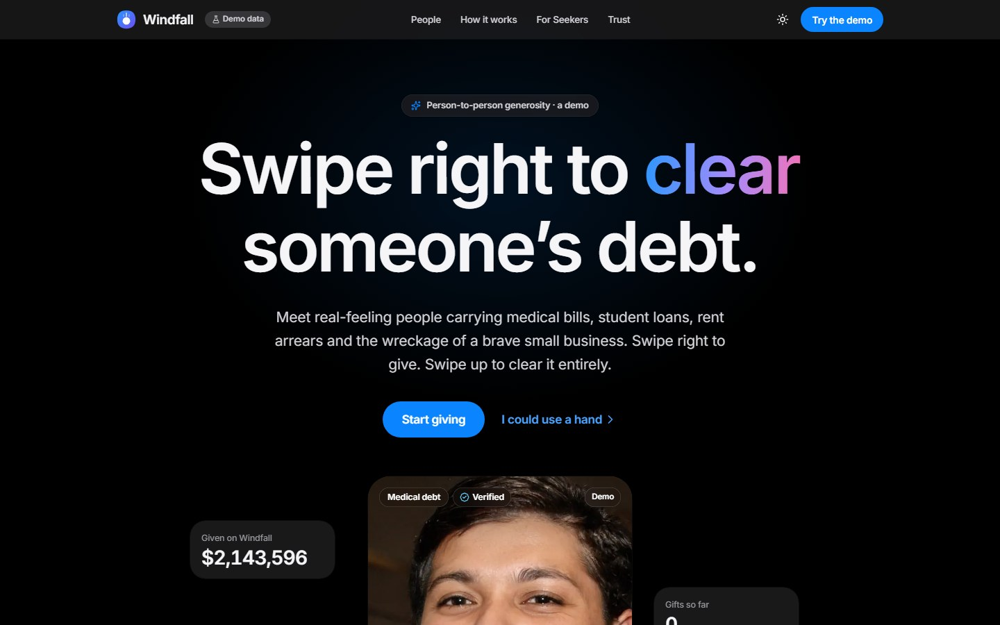 |

| Deck | Drag to give | Give sheet | Seeker dashboard | Dark mode |
|---|---|---|---|---|
| 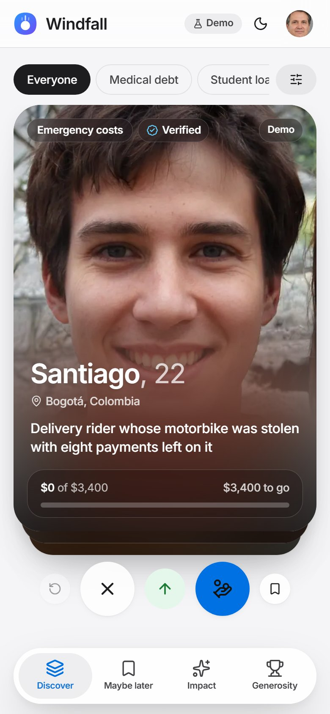 | 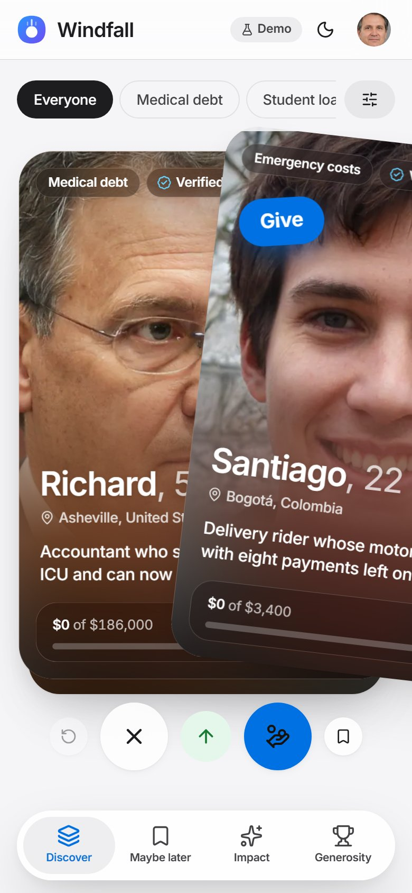 | 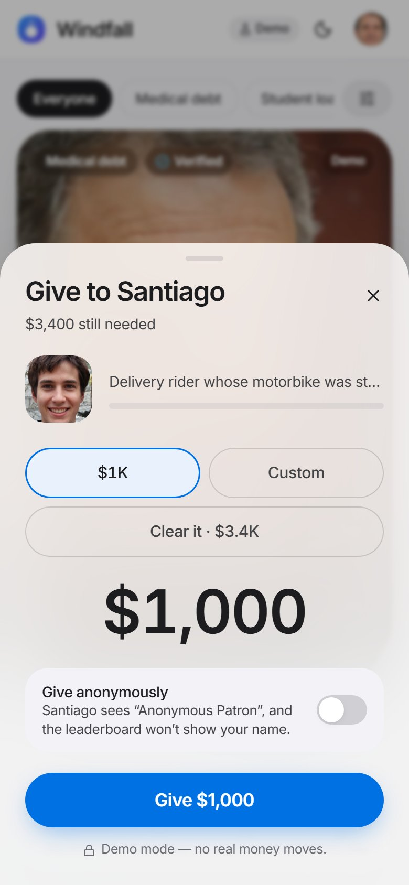 | 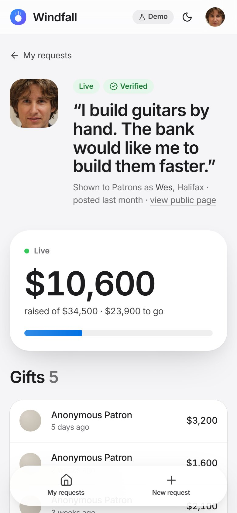 | 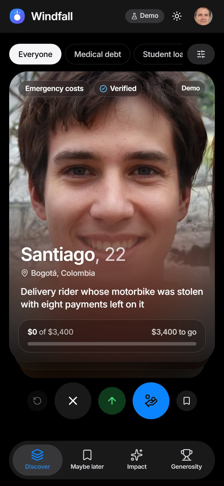 |

| Discover (desktop) | Impact dashboard | Where the money went |
|---|---|---|
| 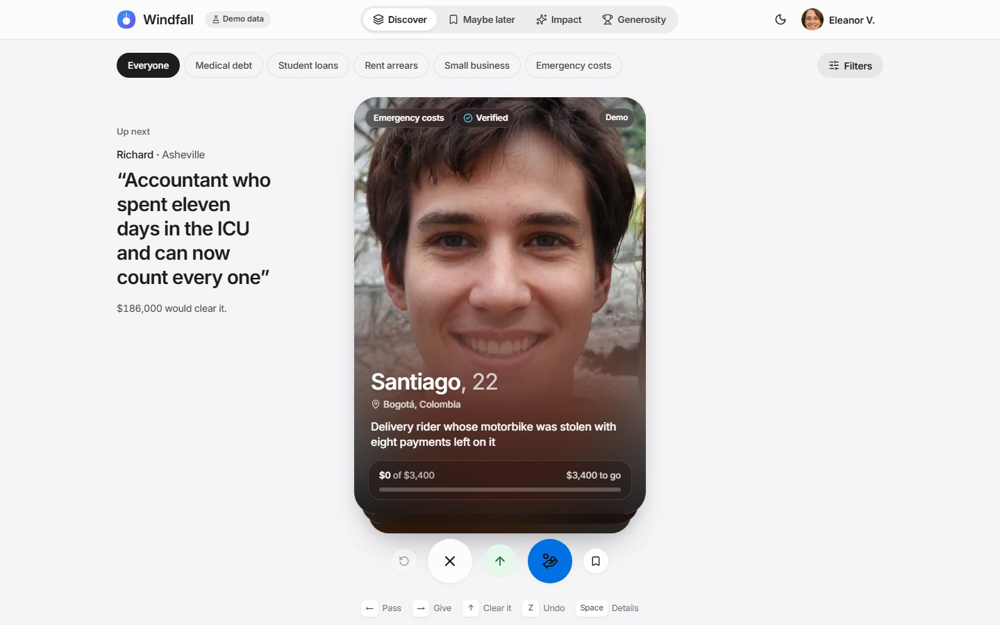 | 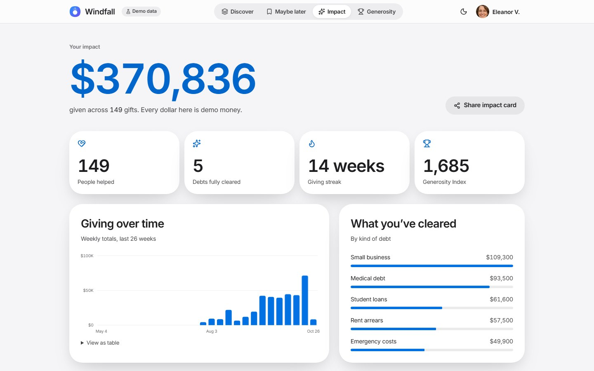 | 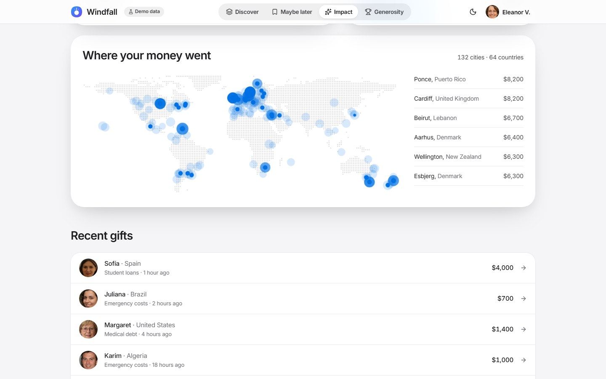 |

## What’s inside

**Design — Apple-inspired**
- San Francisco on Apple devices via the system font stack, Inter (self-hosted, preloaded, metric-matched fallback) everywhere else.
- Apple system greys, a single blue accent, green for “cleared”, glass materials (translucent fill + saturated backdrop blur +
  hairline highlight) for the nav bar, floating iOS-style tab bar, sheets, menus, toasts and photo chips.
- Large continuous-feeling radii, soft diffuse shadows, full light/dark themes. All tokens live in [`src/design/`](src/design).
- Photo-first cards with an Apple Music “Now Playing” treatment: the sharp portrait dissolves into a blurred, saturated copy of itself,
  so the story text never covers a face.

**People**
- **274 fictional people** (261 Seekers + 13 Patrons) across ~60 countries, every one with an AI-generated portrait and a hand-cast
  story, breakdown and updates. Portraits were fetched from a StyleGAN generator, minors and artefacts were filtered out, and each face
  was cast by an agent following [a written brief](docs/CASTING.md).

**Patrons**
- Physics swipe deck (rotation + 3D tilt, velocity-aware flicks, overshoot snap-back, proportional Give/Pass/Clear stamps, stack lean).
- Give sheet ($1K/$10K/$100K/Custom log slider, anonymous toggle) → coin burst, liquid progress fill, ticker.
- Swipe up to clear → full-screen confetti celebration with a shared-layout portrait.
- Undo (Z) for passes, saves and gifts (2-minute reversal), filters, story pages (shared-layout expand), impact dashboard with chart,
  world map and shareable image card, Generosity Index leaderboard, Maybe later list, keyboard shortcuts.

**Seekers**
- Six-step request flow with a live card preview; photo resized on-device; simulated Pending → Verified review.
- Live dashboard, gift wall (anonymous gifts never reveal the Patron), updates and thank-you notes, blur/pause/close controls.

## Architecture

```
Browser (React SPA, hosted on Cloudflare Workers static assets)
  ├── Firebase Auth      Google, email/password, anonymous, demo personas
  ├── Cloud Firestore    all data, live listeners, offline cache
  │     └── firestore.rules   ← the gift ledger is enforced HERE
  └── Firestore REST     public reads for the landing page (no SDK on first paint)
```

Everything except hosting runs on **Firebase (free Spark plan)**. There is no server: each gift is one client transaction that writes

| Document | Purpose |
|---|---|
| `gifts/{id}` | private ledger row (only the giver can read it) |
| `requests/{id}` | `fundedCents += amount`, `giftCount += 1`, `lastGiftId` |
| `requests/{id}/wall/{id}` | public gift wall — amount and (if not anonymous) name, **never** a Patron id |
| `patronStats/{uid}` | leaderboard totals (1 gift/second rate limit) |
| `stats/global` | platform totals |

…and [`firestore.rules`](firestore.rules) checks every write against the others with `get()`/`getAfter()`, so a hand-crafted client
can’t over-fund a request, fudge a total, double-undo, or unmask an anonymous gift. [`tests/rules`](tests/rules) attacks those rules in
the Firestore emulator.

The Firebase SDK is loaded lazily: app routes start it immediately; the landing page uses Firestore’s REST API for live stats and the
people wall, renders a static hero shell before any JavaScript, and only loads Auth at idle.

## Local setup

```bash
git clone https://github.com/Arnav-Dugad/windfall.git && cd windfall
npm install
npm run dev                     # http://localhost:5173 — talks to the live Firebase project
```

To run against local emulators instead: `npm run dev:emulators` in one terminal and `VITE_FIREBASE_EMULATORS=1 npm run dev` in another.

### Scripts

| Command | What it does |
|---|---|
| `npm run check` | oxlint, TypeScript (`tsc -b`) and unit tests (Vitest) |
| `npm run test:rules` | Security-rules tests in the Firestore emulator (needs Java) |
| `npm run test:e2e` | Builds, previews and runs the Playwright smoke test (mobile + desktop) |
| `PLAYWRIGHT_BASE_URL=https://… npm run test:e2e` | Same smoke test against a deployed URL |
| `npm run seed` | Recreates the demo accounts (`firebase auth:import`) and rewrites all demo data in Firestore |
| `npm run deploy:firebase` | Deploys `firestore.rules`, indexes and Auth providers |
| `npm run deploy` | Builds and deploys the SPA to Cloudflare |
| `npx tsx scripts/fetch-faces.ts N` → `process-faces.ts` → `prune-faces.ts` | Portrait pipeline |
| `npx tsx scripts/build-shell.ts <url>` | Regenerates the static landing hero in `index.html` |
| `npx tsx scripts/render-assets.ts` / `capture-media.ts <url>` | OG image & icons / README screenshots & GIF |

### Configuration

- Firebase project: `windfall-give-bb8b` (`.firebaserc`). The web config in `src/lib/firebase.ts` is public by design.
- Demo personas sign in with the shared demo password in `src/lib/firebase.ts`; the seed resets them.
- The seeder account’s password is generated into `.seed.env` (git-ignored) the first time you run `npm run seed`.

## Quality

- **Unit tests:** 13 (money, impact math, schemas). **Rules tests:** 10 (valid gifts, over-funding, tampering, double undo,
  privacy, role checks, request validation). **E2E:** 8 (landing, sign-in, drag-to-give, pass, undo, impact, Seeker).
- Accessibility: every gesture has a button and a shortcut, Radix dialogs, `inert` background cards, live-region announcements,
  table views for charts, AA contrast in both themes, `prefers-reduced-motion` respected everywhere.

---

<sub>Windfall is a design and engineering demo. All people, stories, portraits, gifts and totals are fictional.</sub>
